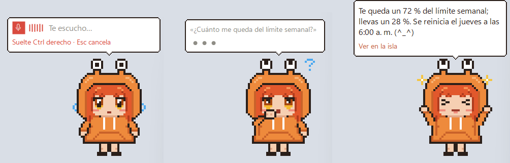
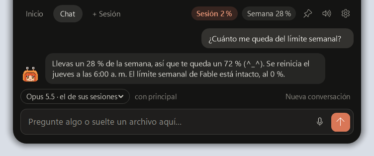
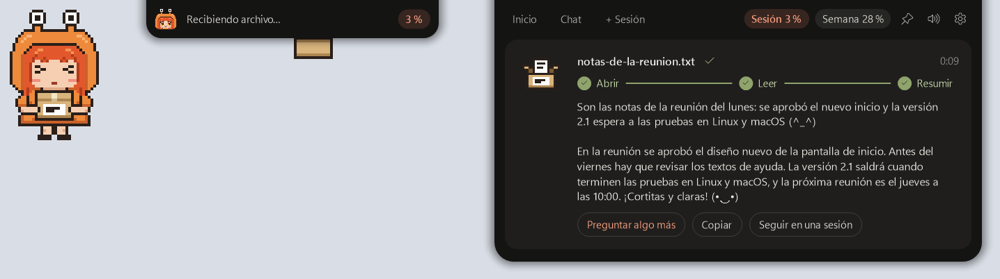

# Uso de Claude

Una pequeña app que vive junto al reloj (en la bandeja de Windows o Linux, o en la barra de menús
de Mac) y le muestra, de un vistazo, cuánto le queda de Claude y qué están haciendo sus sesiones
de Claude Code.

- **Uso:** el porcentaje de su sesión de 5 horas y de la semana, por cuenta, y cuándo se reinicia.
- **Sesiones:** qué sesiones de Claude Code tiene abiertas, si están trabajando, esperando su
  respuesta o ya terminaron, y con qué modelo, esfuerzo y asesor.
- **Nueva sesión:** abre Claude Code en una terminal con la cuenta, la carpeta, el modelo, el
  esfuerzo y el asesor que usted elija para esa sesión.
- **Flujos:** lo que hace cada sesión, paso a paso y animado; clic en una sesión muestra su mapa
  de herramientas. Sale de los archivos de Claude Code: no gasta tokens.
- **Actividad:** un calendario de los últimos 6 meses con cuánto usó Claude cada día.
- **Avisos:** un mensajito con la mascota de Claude cuando una sesión termina, le pregunta algo,
  necesita permiso o falla, y cuando está cerca del límite. Con sonido, que se puede cambiar.
- **Apariencia:** el color de la app (el naranja de Claude u otra paleta) y la mascota que anima el
  ícono al actualizar y sale en los avisos (la clásica, el chibi, el asterisco, los puntos o
  ninguna), en **Ajustes**.
- **Chibi:** una mascota más, Claude con pelo naranja y hoodie de cangrejo. Aparece en los avisos y
  al actualizar, y puede quedarse en el escritorio: muestra lo que hacen sus sesiones (lee un libro,
  busca con la lupa, escribe en su libreta, teclea en su laptop, gira el globo, guía a sus ayudantes,
  piensa o, con otras herramientas, construye una casita), cabecea si suena música y baila cuando no
  hay trabajo, piensa cuando le preguntan algo, duerme si no hay ninguna y baila chachachá con maracas
  cuando se renueva un límite. Cada comportamiento tiene su interruptor en **Ajustes**. Si la molestan a clics, hace puchero, cruza los brazos y termina roja de furia; cuando
  se le pasa, suspira y busca de reojo quién fue. Trae su
  propio estilo de sonido, «Chibi»: un «¡oi!» y, si algo falla, un «¡uwaaa!», con voz de lectura en
  japonés.
- **Mascota en el escritorio y «Hablar»:** cualquier mascota, la clásica también, puede quedarse en
  el escritorio, hacer los mismos gestos y contar los avisos en una nubecita, a su manera.
- **Hablar con Claude** (en Windows, por ahora): la mascota del escritorio y la **isla** de arriba de
  la pantalla responden lo que les pregunte, por escrito o de viva voz; si les suelta un archivo, se
  lo resumen. Vea [Hablar con Claude](#hablar-con-claude).

Necesita tener **Claude Code** instalado y con la sesión iniciada: de ahí lee todo. No guarda
contraseñas ni el texto de sus conversaciones.

## Descargar

| Sistema | Archivo |
|---|---|
| Windows 10 y 11 | [UsoDeClaude-windows-x64.exe](https://github.com/darrenarauz21/claupet/releases/latest/download/UsoDeClaude-windows-x64.exe) |
| macOS con chip Apple (M1, M2, M3…) | [UsoDeClaude-macos-arm64.zip](https://github.com/darrenarauz21/claupet/releases/latest/download/UsoDeClaude-macos-arm64.zip) |
| macOS con Intel | [UsoDeClaude-macos-x64.zip](https://github.com/darrenarauz21/claupet/releases/latest/download/UsoDeClaude-macos-x64.zip) |
| Linux (x64) | [UsoDeClaude-linux-x64.tar.gz](https://github.com/darrenarauz21/claupet/releases/latest/download/UsoDeClaude-linux-x64.tar.gz) |

Los enlaces descargan siempre la última versión; todas están en
[Releases](https://github.com/darrenarauz21/claupet/releases). No hace falta instalar nada
más: cada archivo trae todo lo que necesita.

## Instalar

### Windows

1. Guarde `UsoDeClaude-windows-x64.exe` en una carpeta fija, por ejemplo `Documentos\Uso de Claude`.
2. Ábralo con doble clic. Si Windows muestra «Windows protegió su PC», pulse **Más información** y
   luego **Ejecutar de todas formas** (la app no está firmada).
3. Busque el ícono naranja junto al reloj. Si no aparece, está en la flechita **^**.

### macOS

1. Descomprima el `.zip` que descargó (doble clic).
2. Abra la app **Terminal**, escriba `sh ` (con un espacio), arrastre el archivo
   `preparar-mac.sh` a la ventana y pulse Enter.
3. La app queda en **Aplicaciones** y se abre sola: búsquela arriba a la derecha, en la barra de
   menús.

El paso 2 se hace una sola vez: la app no está firmada por Apple, y el script la autoriza solo
para su Mac. Si macOS pregunta si permite leer «Claude Code-credentials», elija **Permitir
siempre**.

### Linux

1. Descomprima el archivo: `tar -xzf UsoDeClaude-linux-x64.tar.gz`
2. Entre en la carpeta y ejecute: `sh instalar.sh`
3. Busque el ícono en la bandeja. También queda en el menú de aplicaciones.

Si falta algo en su sistema, el instalador le dice qué y cómo instalarlo. En GNOME, el ícono de
la bandeja necesita la extensión «AppIndicator» (en Ubuntu ya viene activada).

## La primera vez

Al abrirla, la app le pregunta qué configurar. Puede aceptar todo con **Aplicar**:

- **Avisos de permisos:** para avisarle cuando Claude Code espere su permiso. Toca la
  configuración de Claude Code, pero antes guarda una copia.
- **Iniciar con el sistema:** para que se abra sola al encender el equipo.
- **Mostrar notificaciones.**

## Cómo se usa

- **Clic en el ícono:** abre la ventana. Arriba están las 3 vistas fijas (al principio **Uso**,
  **Sesiones** y **Actividad**); el botón con la tachuela abre las demás (como **Flujos**) y permite
  cambiar cuál queda fija. El engranaje del pie abre los **Ajustes**.
- **El número del ícono** es el porcentaje de su sesión de 5 horas.
- **Clic en un aviso:** abre la sesión o la cuenta de la que habla.
- **Clic derecho en una sesión:** abrir otra en la misma carpeta, abrir la carpeta o copiar el ID.
- **Menú del ícono** (clic derecho; en Mac, clic): abrir, actualizar, nueva sesión, ajustes y salir.
  Notificaciones, sonido, color, animación, cuentas, inicio con el sistema y diagnóstico están en **Ajustes**.

## Hablar con Claude

En Windows, por ahora. Todo viene apagado: se enciende en **Ajustes › Asistente** (el chat con la
mascota y el micrófono) y en **Ajustes › Isla**. Responde Claude Code con la cuenta que usted elija y
gasta de su plan, como cualquier mensaje.

- **La mascota:** un clic en la mascota del escritorio y escríbale lo que quiera saber (cuánto le
  queda, cómo van sus sesiones, el clima, algo de internet…). Responde corto, en su nubecita.
- **Lo que hace en el equipo:** cambiar el fondo de pantalla, el modo claro u oscuro, el color de
  la app y el volumen; reproducir, pausar o pasar la música, poner una canción, y abrir una página,
  un ajuste de Windows o una app. Lo que no sabe hacer se lo encarga a Claude Code: le ofrece abrir
  una sesión con ese pedido.
- **La isla:** una barra oscura arriba, al centro de la pantalla. Asoma al acercar el cursor y se
  abre con sus sesiones paso a paso, un chat más completo y «+ Sesión». Si lo activa, también le
  deja responder ahí los permisos y las preguntas de Claude Code, sin ir a la terminal.
- **Un archivo:** suéltelo sobre la mascota. Lo guarda en una caja, camina hasta la isla, lo lanza
  y Claude le cuenta de qué trata. También se puede soltar sobre la isla. Si es de un tipo que no
  puede abrir, como un Excel, le ofrece abrirlo en una sesión de Claude Code.
- **Con la voz:** mantenga **Ctrl derecho**, hable y suelte; o tóquelo dos veces y hable sin
  mantenerlo. La voz se pasa a texto en su equipo: la primera vez se descarga el modelo (488 MB).
- **Teclas:** **Ctrl+Alt+Espacio** abre el chat. Si su teclado tiene la **tecla Copilot**, con un
  toque la mascota le escucha (o se abre el chat, si el micrófono está apagado), y Copilot no se
  abre. Las dos se pueden cambiar en **Ajustes › Asistente › Teclas**, con «Grabar…».

## Si algo no funciona

- **No salen avisos:** use **Copiar diagnóstico** en **Ajustes** (el engranaje del pie) y compártalo con quien le
  pasó la app.
- **Dice «Sesión vencida»:** abra Claude Code con esa cuenta y se arregla sola.
- **Para quitarla:** use **Quitar…** en **Ajustes** y después borre la app.

Los detalles técnicos (de dónde sale cada dato, cómo compilarla y empaquetarla) están en
[DETALLES.md](DETALLES.md).
